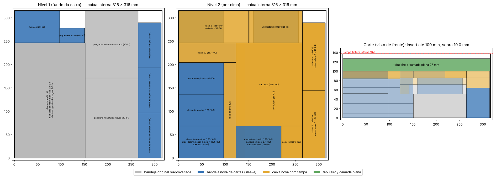

# insertgen: inserts de caixa em STL, com medidas exatas e validação

Gerador paramétrico de organizadores (inserts) para caixas de jogo. Você descreve a caixa, as cartas, os sleeves e
o que vai deitado por cima (tabuleiro, fichas, manual). O `gerar.py` monta as peças e só entrega STL que passou em
todas as checagens:

- **Malha fechada e orientada**: toda aresta tem par, o volume é positivo e não há triângulo degenerado. A checagem é
  feita no sólido e de novo no arquivo gravado, relido do disco.
- **Medida exata**: o tamanho gerado precisa bater com o declarado com tolerância de 0,01 mm. A peça fica apoiada em
  z = 0 e precisa caber na mesa da impressora (256 x 256 mm por padrão).
- **Parede mínima**: a checagem procura, fatia por fatia, qualquer parede mais fina que `parede_min` (1,2 mm). Foi ela
  que pegou o primeiro rebaixo de tampa, que estava com 1,0 mm.
- **Cartas cabem**: cada maço luvado é modelado como um bloco (sleeve x quantidade x espessura). Esse bloco não pode
  tocar o plástico nem passar da borda da bandeja.
- **Montagem**: nenhuma peça pode sair da caixa nem se sobrepor a outra. Peça empilhada precisa de pelo menos 60% da
  base apoiada. O volume do tabuleiro e da camada plana tem que ficar livre até a tampa.

Se qualquer checagem falhar, o comando termina com código 1 e lista o problema.

```
pip install -r tools/inserts/requirements.txt
python3 tools/inserts/gerar.py                    # gera tools/inserts/saida/robinson-crusoe-ce/
python3 -m unittest discover -s tools/inserts/tests -t tools/inserts
python3 -I tools/inserts/analisar_original.py insert.zip   # diagnostica um insert pronto
```

## Robinson Crusoe — Edição de Colecionador, com sleeves Bucaneiros

### O problema no insert original

O zip enviado é o insert **js500** (Printables 953093) mais o remix com Mistérios (Mystery Tales). O `analisar_original.py`
mede os poços de carta direto nos STLs:

| Bandeja original | Poço | Carta grande em Bucaneiros Padrão Euro | Resultado |
|---|---|---|---|
| `obj_5_cards-events-and-wreckage` | 93,0 mm | 95,0 mm (+1 de folga = 96) | **não cabe: faltam 3,0 mm** |
| `obj_6_Mystery Tales Cards` | 94,8 mm | 95,0 mm | **não cabe: faltam 1,2 mm** |
| `obj_8_cards-inventions...` (pequenas) | 74,0 mm | 71,0 mm (Mini Euro) | cabe |
| `obj_9_cards-beasts` (pequenas) | 50,0 mm | 47,5 mm | cabe |

O próprio autor do js500 diz que o projeto é para o **playmat de neoprene** e que o tabuleiro de papelão só cabe se a
tampa ficar levantada. Por isso o original também não tem espaço para o tabuleiro.

### A solução atual (versão 5): projetos publicados + espaço do tabuleiro

> **A caixa da edição brasileira (Conclave) é menor.** Medida com trena em 26/11/2026, ela tem ~315,5 mm por dentro,
> contra ~320 mm da caixa da Gamefound. O js500 e o PengLord ocupam 318,4 mm e não caberiam. Por isso a versão 5 ocupa
> no máximo **314 x 314 mm**. As duas bandejas de miniaturas do PengLord saem **encurtadas 1,4% em Y** (o `gerar.py`
> gera as duas a partir dos originais em `dados/terceiros/penglord/`), e a coluna de cartas em pé ficou mais estreita.
> A altura útil medida é ~138 mm.

A versão 5 junta o que os projetos publicados já resolvem e só acrescenta o que nenhum deles tem: o espaço do
tabuleiro e as bandejas de carta para os sleeves Bucaneiros.

| Parte | De onde vem |
|---|---|
| Personagens, peças, abrigo, fichas, dados, recursos | bandejas originais do js500/Hooper (`obj_11` a `obj_16`; `obj_19` vai dentro do `obj_12`) |
| Todas as miniaturas: 16 figuras de personagem, Sexta-feira, Cão, acampamento modular de 8 peças, cavalo, papagaio, gato e 10 itens | as duas bandejas do **PengLord**: `mini_tray_-_large` e `mini_tray_-_camp`, somadas 113,6 x 318,4 mm |
| Cartas (CHIMERA e MINI EURO) | geradas aqui |
| Espaço do tabuleiro | gerado aqui: topo plano a 86 mm |

**Planta:**
- **Coluna 1 (0–151,2):** componentes do js500 até 83 mm, com a caixa estreita ao lado das fichas e dados. Embaixo
  dela, a faixa do fundo leva Eventos deitado (0–52), Mistério deitado com as Especiais por baixo (52–86) e as cartas
  pequenas em pé.
- **Coluna 2 (151,2–264,8):** miniaturas do PengLord (0–51) + recursos (51–71) + placas do vulcão deitadas (71–85).
- **Coluna 3 (264,8–318,4):** 3 bandejas de carta em pé com divisórias soltas (0–64) e 2 caixas com tampa por cima:
  - Aventura Construir e Coletar;
  - Aventura Explorar e Animais;
  - Procurando na Praia, Traços, Traços Secretos e Moral Dramática.
- **Por cima de tudo:** tabuleiro, fichas de cenário, manual e os 2 guias (~35 mm estimados). Sobram 6 mm numa caixa
  de 127 e 3 mm numa de 124.

**Nomes em relevo e descartes (27/11/2026):**
- Cada bandeja de carta tem o nome gravado (0,6 mm) nas duas paredes curtas, legível de fora:
  EVENTOS, MISTÉRIO, CONSTRUIR/COLETAR, EXPLORAR/ANIMAIS, EXPANSÕES, PEQUENAS e os DESCARTES.
  As paredes curtas das bandejas em pé passaram a ter 2 mm para caber a gravação.
- **5 bandejas de descarte**, do mesmo tamanho das de compra, que vão para a mesa ao lado do monte:
  - Eventos: no vão livre sobre o acampamento do PengLord;
  - Construir, Coletar e Explorar: na camada de cima;
  - Mistério: na camada de cima.
- **Camada de cima (até 100 mm):** os descartes mais 8 bandejas abertas (fichas e dados soltos), que formam um piso
  plano para o tabuleiro. As placas do vulcão agora ficam numa bandeja rasa própria (`bandeja-vulcao`).
- O insert subiu de 86 para **100 mm**. Com a pilha de cima medida (~24 mm, 26 no projeto), sobram ~11 mm até a
  tampa (8 mm no pior caso).

**Tampas e conteúdo (27/11/2026):**
- As 8 bandejas abertas da camada de cima ganharam tampa embutida, rente à borda, e viraram `caixa-a1` a
  `caixa-e`. Com isso a caixa pode ser guardada em pé.
- Toda tampa tem o conteúdo gravado em cima. O que vai em cada uma está em `projetos/robinson-crusoe-ce.json`,
  `conteudo_bandejas`: troque o texto ali e rode `gerar.py`.

**A única medida que nenhum projeto publicado tem:** a espessura da pilha de cima, de preferência junto com a das
placas do vulcão.



### O que imprimir

- **Antes de tudo:** as peças de `saida/teste-encaixe/` (`python3 tools/inserts/gerar_teste.py`), para conferir o
  sleeve.
- Os STLs de `saida/robinson-crusoe-ce/`. Imprima **5 cópias** da `divisoria-grandes` e **2 cópias** da
  `divisoria-pequenas` (30 arquivos ao todo).
- Do **js500/Hooper** (o seu zip): `obj_11` a `obj_16` e `obj_19`.
- As bandejas de miniaturas **não** saem do zip do PengLord: use `penglord-miniaturas-figuras.stl` e
  `penglord-miniaturas-acampamento.stl`, geradas aqui já encurtadas (CC BY-NC-SA 4.0, crédito ao PengLord).
- PLA ou PETG, camada de 0,2 mm, sem suporte, com a boca para cima. As bandejas de carta em pé têm parede de 1,2 mm:
  use 3 perímetros.

## Estrutura

```
insertgen/geom.py      primitivas (caixa arredondada, cavidade em concha, entalhe de dedo)
insertgen/cartas.py    sleeves (catálogo Bucaneiros), carta luvada, altura do maço
insertgen/pecas.py     bandeja de baralhos deitada/em pé, bandeja de fichas com tampa, divisória
insertgen/validar.py   malha, medidas, parede fina, conteúdo cabe, montagem, mesa da impressora
insertgen/previa.py    planta, corte e vista 3D (PNG)
insertgen/stl.py       STL binário só com numpy;  insertgen/tmf.py  leitor de 3MF
projetos/              layout (.py) + medidas (.json) do Robinson Crusoe; versões 2 a 5 escolhidas pelo JSON
dados/                 catálogo de sleeves Bucaneiros
```
